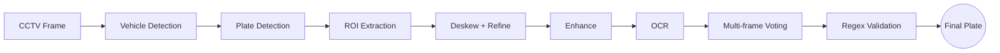
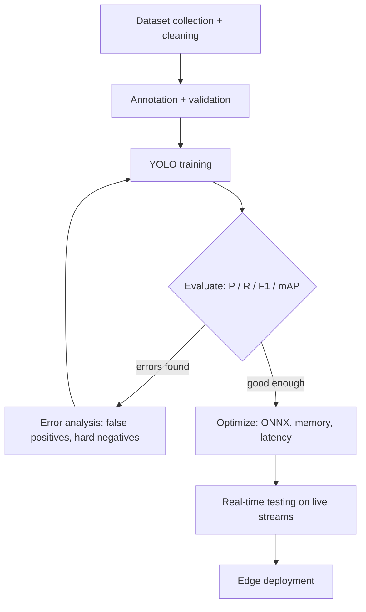

<p align="center">
  
</p>

<p align="center">
  
</p>

<p align="center">
  <a href="https://chandramahesh24.github.io">
    
  </a>
</p>

<p align="center">
  <a href="https://github.com/ChandraMahesh24"></a>
  <a href="https://www.linkedin.com/in/mahesh-chandra-63440a239"></a>
  <a href="mailto:mahesh.mahi.cnd@gmail.com"></a>
  
</p>

---

## `> about`

I'm an **AI Engineer** specializing in **Computer Vision, Deep Learning, OCR, ANPR and Edge AI**, with hands-on experience building AI solutions for real industrial applications.

My work covers the full lifecycle:

```text
Data preparation → Annotation → Preprocessing → Training → Evaluation → Optimization → Deployment
```

I enjoy solving hard computer vision problems, improving model accuracy, optimizing inference speed, and turning models into reliable real-world applications.

> 🟢 **Open to opportunities** in AI Engineering, Computer Vision, Deep Learning, Machine Learning and Edge AI.

---

## `> tech stack`

<p>
  
  
  
  
  
  
  
  
  
  
  
  
</p>

<details>
<summary><b>More about my expertise (click to expand)</b></summary>

<br>

| Area | What I do |
|---|---|
| **Detection** | YOLOv8 / YOLO11, object detection, object tracking, real-time video analytics |
| **OCR / ANPR** | PaddleOCR, OCR post-processing, license plate recognition, multi-frame voting |
| **Data** | Roboflow, dataset engineering, annotation review, class balancing, hard-negative analysis |
| **Optimization** | ONNX Runtime, model optimization, memory and latency tuning |
| **Edge** | NVIDIA Jetson, RTSP / CCTV streams |
| **Monitoring** | ROI and zone-based monitoring, alert systems |
| **Pipelines** | Configurable AI pipelines using JSON / YAML, SQLite event storage |

</details>

---

## `> projects`

<details open>
<summary><b>🚘 ANPR / License Plate Recognition</b></summary>

<br>

Vehicle → plate → OCR, built for blurry, angled, real CCTV frames.



`YOLO11` `OpenCV` `PaddleOCR` `ONNX Runtime` `Python`

</details>

<details>
<summary><b>📦 Industrial Object Detection</b></summary>

<br>

- Sack bag, tin and carton box detection
- Plywood detection
- Dataset engineering and accuracy tuning for real plant lighting

`YOLOv8` `Roboflow` `PyTorch` `OpenCV`

</details>

<details>
<summary><b>👥 Person Detection & Counting</b></summary>

<br>

- Person detection with object tracking across frames
- Counting with zone lines
- Real-time video analytics

`YOLO11` `Tracking` `OpenCV` `Python`

</details>

<details>
<summary><b>🦺 PPE Detection & Compliance Monitoring</b></summary>

<br>

- Helmet and safety equipment detection
- Dataset balancing, annotation review, hard-negative analysis
- Compliance monitoring and alerts

`YOLOv8` `Roboflow` `PyTorch` `OpenCV`

</details>

<details>
<summary><b>🔥 Fire & Smoke Detection</b></summary>

<br>

- Real-time detection with instant alerts
- False-positive analysis and retraining
- Deployment testing on live streams

`YOLOv8` `RTSP` `Jetson` `SQLite`

</details>

<details>
<summary><b>🚗 Vehicle Detection & Classification</b></summary>

<br>

- Multiple vehicle classes on CCTV streams
- Camera angle and positioning analysis
- Model performance evaluation

`YOLO11` `OpenCV` `ONNX Runtime` `NumPy`

</details>

<details>
<summary><b>📍 ROI / Zone-based Monitoring & Alerts</b></summary>

<br>

- Per-camera ROI and zone rules
- Configurable pipelines in JSON / YAML
- Events and alerts stored in SQLite

`OpenCV` `JSON/YAML` `SQLite` `Python`

</details>

---

## `> how I build models`



I care about what happens after training: camera position, image quality, preprocessing, dataset quality and inference speed often matter as much as the model itself.

---

## `> github stats`

<p align="center">
  
  
</p>

<p align="center">
  
</p>

---

## `> connect`

<p align="center">
  <a href="https://chandramahesh24.github.io"><b>Portfolio</b></a> ·
  <a href="https://www.linkedin.com/in/mahesh-chandra-63440a239"><b>LinkedIn</b></a> ·
  <a href="mailto:mahesh.mahi.cnd@gmail.com"><b>Email</b></a>
</p>

<p align="center">
  
</p>
