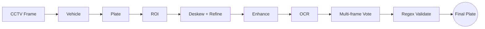
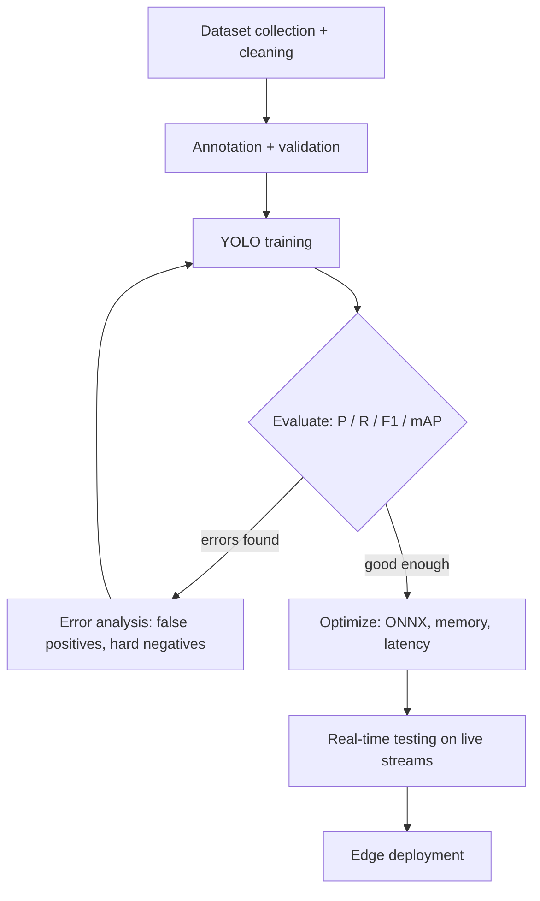

<p align="center">
  
</p>

<p align="center">
  <a href="https://chandramahesh24.github.io">
    
  </a>
</p>

<p align="center">
  <a href="https://chandramahesh24.github.io"></a>
  <a href="https://www.linkedin.com/in/mahesh-chandra-63440a239"></a>
  <a href="mailto:mahesh.mahi.cnd@gmail.com"></a>
</p>

<p align="center">
  <b><a href="#-what-i-do">What I do</a></b> ·
  <b><a href="#-more-demos">Demos</a></b> ·
  <b><a href="#-projects">Projects</a></b> ·
  <b><a href="#-how-i-build-models">How I build</a></b> ·
  <b><a href="#-tech-stack">Stack</a></b> ·
  <b><a href="#-connect">Connect</a></b>
</p>

---

## 👋 Hi, I'm Mahesh

I'm an **AI Engineer** in **Computer Vision, Deep Learning, OCR, ANPR and Edge AI**. I build vision systems for real industrial use, the kind that have to work on blurry, angled, badly lit camera feeds, not just clean datasets.

```text
Data → Annotation → Preprocessing → Training → Evaluation → Optimization → Deployment
```

> 🟢 **Open to roles** in AI Engineering, Computer Vision, Deep Learning, Machine Learning and Edge AI.

---

## ⚡ What I do

<table>
<tr>
<td width="33%" valign="top">

### 👁️ Detect
YOLOv8 and YOLO11 models for objects, people, vehicles, PPE, fire and smoke. Tracking across frames and zone-based alerts.

</td>
<td width="33%" valign="top">

### 🔤 Read
ANPR and OCR with PaddleOCR. Deskewing, enhancement, multi-frame voting and Indian plate regex validation.

</td>
<td width="33%" valign="top">

### 🚀 Deploy
ONNX Runtime optimization, NVIDIA Jetson and RTSP / CCTV streams, with events and alerts stored in SQLite.

</td>
</tr>
</table>

---

## 🎬 More Demos

<details open>
<summary><b>ROI monitor · ANPR pipeline · Metrics lab</b></summary>

<br>

<p align="center">
  <a href="https://chandramahesh24.github.io">
    
  </a>
</p>

<p align="center"><sub>Click the image to open the full interactive portfolio.</sub></p>

</details>

---

## 🧩 Projects

<details open>
<summary><b>🚘 ANPR / License Plate Recognition</b> &nbsp;·&nbsp; <code>YOLO11</code> <code>PaddleOCR</code> <code>OpenCV</code></summary>

<br>

Vehicle → plate → OCR, built for blurry, angled, real CCTV frames.



- Perspective correction and deskewing
- Multi-frame OCR voting
- Indian plate regex correction
- Blur, contrast and brightness checks

</details>

<details>
<summary><b>📦 Industrial Object Detection</b> &nbsp;·&nbsp; <code>YOLOv8</code> <code>Roboflow</code> <code>PyTorch</code></summary>

<br>

- Sack bag, tin and carton box detection
- Plywood detection
- Dataset engineering in Roboflow and accuracy tuning for real plant lighting

</details>

<details>
<summary><b>👥 Person Detection & Counting</b> &nbsp;·&nbsp; <code>YOLO11</code> <code>Tracking</code> <code>OpenCV</code></summary>

<br>

- Person detection with object tracking across frames
- Counting with zone lines
- Real-time video analytics

</details>

<details>
<summary><b>🦺 PPE Detection & Compliance</b> &nbsp;·&nbsp; <code>YOLOv8</code> <code>Roboflow</code> <code>PyTorch</code></summary>

<br>

- Helmet and safety equipment detection
- Dataset balancing, annotation review, hard-negative analysis
- Compliance monitoring and alerts, retraining after error review

</details>

<details>
<summary><b>🔥 Fire & Smoke Detection</b> &nbsp;·&nbsp; <code>YOLOv8</code> <code>RTSP</code> <code>Jetson</code></summary>

<br>

- Real-time detection with instant alerts
- False-positive analysis and retraining
- Deployment testing on live streams

</details>

<details>
<summary><b>🚗 Vehicle Detection & Classification</b> &nbsp;·&nbsp; <code>YOLO11</code> <code>ONNX Runtime</code></summary>

<br>

- Multiple vehicle classes on CCTV streams
- Camera angle and positioning analysis
- Model performance evaluation

</details>

<details>
<summary><b>📍 ROI / Zone Monitoring & Alerts</b> &nbsp;·&nbsp; <code>OpenCV</code> <code>SQLite</code> <code>JSON/YAML</code></summary>

<br>

- Per-camera ROI and zone rules
- Configurable pipelines in JSON / YAML
- Events and alerts stored in SQLite

</details>

---

## 🔬 How I build models



> I care about what happens after training. Camera position, image quality, preprocessing, dataset quality and inference speed often matter as much as the model itself.

---

## 🛠️ Tech Stack

<p>
  
  
  
  
  
  
  
  
  
  
  
  
</p>

<details>
<summary><b>Skills by area</b></summary>

<br>

| Area | What I do |
|---|---|
| **Detection** | YOLOv8 / YOLO11, object tracking, real-time video analytics |
| **OCR / ANPR** | PaddleOCR, OCR post-processing, plate recognition, multi-frame voting |
| **Data** | Roboflow, dataset engineering, annotation review, class balancing, hard-negative analysis |
| **Optimization** | ONNX Runtime, model optimization, memory and latency tuning |
| **Edge** | NVIDIA Jetson, RTSP / CCTV streams |
| **Monitoring** | ROI and zone-based monitoring, alert systems |
| **Pipelines** | Configurable AI pipelines in JSON / YAML, SQLite event storage |

</details>

---

## 📬 Connect

<p align="center">
  Have a vision problem that has to work on real cameras? Let's talk.
</p>

<p align="center">
  <a href="https://chandramahesh24.github.io"><b>Portfolio</b></a> ·
  <a href="https://www.linkedin.com/in/mahesh-chandra-63440a239"><b>LinkedIn</b></a> ·
  <a href="mailto:mahesh.mahi.cnd@gmail.com"><b>Email</b></a>
</p>
